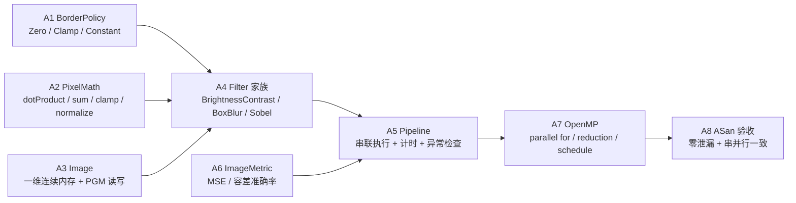

# MiniCV


用 **C++17 + OpenMP** 从零搭一个微型计算机视觉流水线：读 PGM 灰度图 → 按可插拔的**边界策略**做**卷积滤波**（亮度/对比度、均值模糊、Sobel 边缘检测）→ 串联成 **Pipeline** → 用 **MSE** 校验结果 → 用 **OpenMP** 把每一层并行化 → 最后用 **AddressSanitizer** 证明零内存泄漏。

**零第三方依赖**：不装 OpenCV，不引 Eigen，只用 C++ 标准库和 `-fopenmp`。整个项目约 1000 行，每个类、每条 `#pragma` 都能在半小时内讲清楚原理。

仅用于教学目的。

---

**目录**

[这是什么](#这是什么) · [核心心智模型](#核心心智模型) · [架构总览](#架构总览) · [目录结构](#目录结构) · [模块详解](#模块详解) · [构建与运行](#构建与运行) · [验收清单](#验收清单) · [常见报错速查](#常见报错速查) · [实现进度](#实现进度) · [延伸阅读](#延伸阅读)

---

## 这是什么

一个**为了把「C++ 语法 + 数值算法 + 并行编程」一次踩实而设计的练习项目**。

它的结构来自大学并行计算课程（Praktikum 1）里的神经网络练习，只是把「层 + 激活函数 + 损失函数」平移成「图像算子 + 边界策略 + 图像指标」。两者的工程骨架完全同构，练的是同一批技能：

| Praktikum 1（DNN） | MiniCV（CV） | 训练的同一个技能 |
| --- | --- | --- |
| `ActivationFunction` + 4 个子类 | `BorderPolicy` + 3 个子类 | 头文件拆分、`namespace`、继承、纯虚函数、`override` |
| `MathUtils::dotProduct` / `sum` | `PixelMath::dotProduct` / `sum` / `clamp` | `const std::vector<T>&` 传参、`<cmath>` |
| `normalize` 模板 | `normalize` 模板 | **函数模板必须写在头文件**、`std::max_element` |
| `Layer`（权重矩阵 + 前向） | `Image`（一维数组 + PGM I/O）、`Filter`（卷积） | 二维到一维映射、`<fstream>` 二进制读写、双缓冲 |
| `Network`（管 `Layer*` 与 loss） | `Pipeline`（管 `Filter*` 与 metric） | **指针所有权**、析构、`= delete` 防浅拷贝 |
| `BinaryCrossEntropy` | `MSEMetric` | 多态基类指针调用、浮点比较、防除零 |
| —— | **OpenMP 并行化** | `parallel for`、数据竞争、`reduction`、`schedule` |
| 无内存泄漏 | **ASan 零泄漏 + 串并行一致** | `-fsanitize=address`、`virtual` 析构、UB |

要解决的问题很具体：

- 为什么卷积核滑到图像边缘会越界？越界时该补 0、补常数，还是复制最近边缘？——**边界策略**
- 为什么图像在内存里是一条一维数组？`r * width + c` 里的 `width` 为什么不能写成 `height`？——**行主序映射**
- 为什么滤镜必须「读原图、写新图」，不能原地改？——**读写分离**，也是并行安全的前提
- 为什么开 8 个线程没有快 8 倍？——**Amdahl 定律 + 内存带宽墙 + 伪共享**
- 并行改完之后怎么证明结果没算错？——**MSE < 1e-12**，肉眼看图不算证明

---

## 核心心智模型

动手前只需要记住三条直觉，后面每一关都围着它们转。

### 一、图像在内存里是一条一维纸带

一张 `height × width` 的灰度图，在内存里是**一条连续数组**，按**行主序**把二维拍平：

```text
二维视角 (height = 3, width = 4):
       列 c=0   c=1   c=2   c=3
行 r=0 [ (0,0) (0,1) (0,2) (0,3) ]
行 r=1 [ (1,0) (1,1) (1,2) (1,3) ]
行 r=2 [ (2,0) (2,1) (2,2) (2,3) ]

一维内存视角 (长度 = 3 × 4 = 12):
idx:     0     1     2     3  |  4     5     6     7  |  8     9    10    11
内容:  (0,0) (0,1) (0,2) (0,3)|(1,0) (1,1) (1,2) (1,3)|(2,0) (2,1) (2,2) (2,3)
```

坐标与下标的换算只有一条公式：

$$
\mathrm{idx}(r, c) = r \times \mathrm{width} + c
$$

直觉：先跳过前面 $r$ 整行（每行 `width` 个格子），再往右走 $c$ 格。

> [!WARNING]
> 写成 `r * height + c` 是最经典的死穴。正方形图测不出问题，一换长方形图立刻越界崩溃或图像斜裂。
> `r` 的上限是 `height`，但**跨行步长永远是 `width`**。

为什么不用 `std::vector<std::vector<double>>`？因为外层 vector 只存指向各行的指针，每一行是堆上独立申请的一块内存，CPU 顺序读像素时会在内存里到处跳，缓存不断未命中。图片动辄几百万像素，必须用一整条连续内存——这就是 `Image` 内部只存一个 `std::vector<double>` 的全部理由。

### 二、PGM：三行纯文本头 + 一串像素

PGM 是 Unix 世界的极简无损灰度图格式，五分钟就能手写解析器，不需要 `libpng`。

```text
P5                  <-- 第 1 项：魔数，"P5" = 二进制灰度，"P2" = 文本灰度
# some comment      <-- 可选：任意多个以 # 开头的整行注释，可以出现在任何标记之前
640 480             <-- 第 2、3 项：宽度 width、高度 height（空白分隔）
255                 <-- 第 4 项：最大灰度 maxVal（通常 255）
[像素数据]           <-- P2：width*height 个十进制整数（空白分隔）
                        P5：width*height 个原始字节（0~255），紧密排列、无任何分隔符
```

> [!CAUTION]
> 读二进制（P5）时，读完 `maxVal`（比如 `255`）后读指针停在那 1 个空白字符上。此时若用 `>> std::ws` 去「跳过空白」，而紧跟其后的像素字节恰好是 `10`（换行）或 `32`（空格），这个像素就会被吃掉——整张图错位、最后少一个像素。
> **读 `maxVal` 之后只能调用一次 `file.get()`，精准吃掉那 1 个字符。**

新手自测首选：用 `P2`（纯文本）格式手敲一张 3×3 图，零门槛验证读写闭环。

### 三、卷积 = 小方格滑动做点积，而读写必须分离

模糊、锐化、边缘检测，数学上是同一个动作：拿一个小权重方格（**卷积核 Kernel**）在原图上逐像素滑动，把覆盖到的像素与权重对应相乘再求和，写进新图的同一位置。

```text
原图局部 3×3                   3×3 卷积核                 输出新图
┌────┬────┬────┐              ┌────┬────┬────┐
│ 10 │ 20 │ 30 │              │ -1 │  0 │ +1 │
├────┼────┼────┤   对应位置   ├────┼────┼────┤   Σ 相乘
│ 40 │ 50 │ 60 │     相乘     │ -2 │  0 │ +2 │  ──────►  新像素(r,c)
├────┼────┼────┤              ├────┼────┼────┤
│ 70 │ 80 │ 90 │              │ -1 │  0 │ +1 │
└────┴────┴────┘              └────┴────┴────┘
```

> [!CAUTION]
> **绝对禁止原地修改（in-place update）。** 为了省内存把结果直接写回原图，串行时会算错（后续像素读到的已是新值），并行时会数据竞争（每次运行结果都不一样）。
> **铁律**：每个滤镜都接收 `const Image& input`，内部新建 `Image output`，算完 `return output`。这是 OpenMP 能安全并行的前提。

---

## 架构总览



一次完整执行的流程：

```text
input.pgm ──► Image::loadPGM ──► Pipeline::execute
                                     │
                    ┌────────────────┼────────────────┐
                    ▼                ▼                ▼
             BrightnessContrast   BoxBlur          Sobel
             (点算子, 无邻居)   (3×3 均值)      (Gx, Gy, 幅值)
                    │                │                │
                    └──── 每步记录耗时 stepTimingsMs_ ┘
                                     ▼
                              output_edges.pgm
                                     ▼
                     evaluateAgainstReference(ref) ──► MSE / 准确率
```

---

## 目录结构

```text
.
├── CMakeLists.txt                     # 构建脚本（GLOB_RECURSE 自动收集 src/**.cpp）
├── include/
│   ├── border/
│   │   ├── BorderPolicy.h             # [A1] 抽象基类
│   │   ├── ZeroBorder.h               # [A1] 越界补 0
│   │   ├── ClampBorder.h              # [A1] 越界复制最近边缘
│   │   └── ConstantBorder.h           # [A1] 越界补指定常数
│   ├── utils/
│   │   └── PixelMath.h                # [A2] 声明 + 模板定义（模板必须放头文件）
│   ├── core/
│   │   ├── Image.h                    # [A3] 图像容器 + PGM I/O
│   │   └── Pipeline.h                 # [A5] 流水线
│   ├── filter/
│   │   ├── Filter.h                   # [A4] 抽象基类
│   │   ├── BrightnessContrastFilter.h # [A4] 点算子
│   │   ├── BoxBlurFilter.h            # [A4] 均值模糊
│   │   └── SobelFilter.h              # [A4] 边缘检测
│   └── metric/
│       ├── ImageMetric.h              # [A6] 抽象基类
│       └── MSEMetric.h                # [A6] 均方误差
├── src/
│   ├── border/  ZeroBorder.cpp  ClampBorder.cpp  ConstantBorder.cpp
│   ├── utils/   PixelMath.cpp
│   ├── core/    Image.cpp  Pipeline.cpp
│   ├── filter/  BrightnessContrastFilter.cpp  BoxBlurFilter.cpp  SobelFilter.cpp
│   ├── metric/  MSEMetric.cpp
│   └── main.cpp                       # [A7] 基准测试入口
├── data/                              # .pgm 测试图（运行时创建）
└── .devcontainer/                     # 可复现开发环境（Ubuntu 24.04 + GCC 13）
```

**命名规律**：每个 `.h` 配一个同名 `.cpp`；唯一例外是纯抽象基类（`BorderPolicy.h`、`Filter.h`、`ImageMetric.h`），它们只有 `= default` 和 `= 0`，没有函数体需要落地。

---

## 模块详解

### Aufgabe 1 — 边界策略 `BorderPolicy`

3×3 卷积核滑到左上角 `(0, 0)` 时要读 `(-1, -1)`，越界了。不同算法对越界坐标有不同的「编造规则」，于是抽象成一个安全取像素器：

$$
\mathrm{fetch}(\mathrm{img}, r, c) =
\begin{cases}
\mathrm{img}(r, c), & 0 \le r < H \ \text{且}\ 0 \le c < W \\[4pt]
0.0, & \text{越界，ZeroBorder} \\[4pt]
v, & \text{越界，ConstantBorder}(v) \\[4pt]
\mathrm{img}\bigl(\mathrm{clamp}(r, 0, H-1),\ \mathrm{clamp}(c, 0, W-1)\bigr), & \text{越界，ClampBorder}
\end{cases}
$$

| 子类 | 越界时返回 | `getName()` |
| --- | --- | --- |
| `ZeroBorder` | `0.0` | `"zero"` |
| `ClampBorder` | 最近的边缘像素 | `"clamp"` |
| `ConstantBorder` | 构造时传入的 `fillValue_` | `"constant"` |

抽象成类的价值：三种规则若在各滤镜里写 `if/else`，同一段逻辑要抄三遍；有了多态，调用方只写 `policy->fetch(img, r, c)`，具体走哪条规则由传入的对象决定。

> [!TIP]
> 施工顺序陷阱：`BorderPolicy::fetch` 的实现要调用 `img.at(r, c)`，而 `Image` 属于 Aufgabe 3。若严格按 1→2→3 顺序写，A1 的 `.cpp` 必然报 `invalid use of incomplete type 'class minicv::Image'`。
> 解法：头文件里 `class Image;` 前置声明就够写**声明**（参数是引用，不需要知道内部结构）；到 `.cpp` 里再 `#include "core/Image.h"`。所以先写 A1 的四个 `.h`，跳到 A3 把 `Image` 写完，再回头补 A1 的 `.cpp`。

### Aufgabe 2 — 数学工具箱 `PixelMath`

| 函数 | 数学定义 | 边界情况 |
| --- | --- | --- |
| `dotProduct(a, b)` | $\sum_i a_i b_i$ | 长度不等 → `throw std::invalid_argument`；两空 → `0.0` |
| `sum(v)` | $\sum_i v_i$ | 空数组 → `0.0` |
| `clamp(x, L, R)` | $\min(\max(x, L), R)$ | $x<L \Rightarrow L$；$x>R \Rightarrow R$ |
| `normalize(v, targetMax)` | $y_i = \dfrac{x_i}{M} \cdot \text{targetMax}$，$M=\max_i x_i$ | $M = 0$ → 全 `0.0`（防除零：全黑图） |

`normalize` 是**函数模板**，模板定义必须放在 `.h` 里——否则实例化时找不到函数体，链接期报 `undefined reference`。它的现实用途：Sobel 梯度幅值可能落在 `0 ~ 1020`，直接截断成 `0~255` 会全白，先按最大值归一化再乘 255，才能得到可看的边缘图。

为什么内部一律用 `double` 而不是 `uint8_t`：滤镜中间过程会出现小数和负数（Sobel 的 `Gx` 可以是 `-1020`）。全程 `double` 计算，只在写文件那一步做 `clamp(0, 255)` + 四舍五入 + 转 `uint8_t`，能省掉 90% 的「图怎么花了/怎么全黑了」的调试时间。

### Aufgabe 3 — 图像容器 `Image` 与 PGM 读写

内部只有一条连续内存：

```cpp
std::vector<double> data_;   // 长度 = width_ * height_
```

公开接口（`at` 的 `const` 重载是重点）：

| 接口 | 语义 |
| --- | --- |
| `Image(int w, int h, double initVal = 0.0)` | 建图并按初值填充；宽高非正 → `invalid_argument` |
| `Image(int w, int h, const std::vector<double>& flat)` | 从一维数组接管数据（长度不符 → 抛异常） |
| `getWidth()` / `getHeight()` / `getSize()` | `noexcept` 只读访问 |
| `getData()` | 返回 `const std::vector<double>&`，便于单层循环做归约 |
| `at(r, c)` / `at(r, c) const` | **带越界检查**，越界抛 `std::out_of_range` |
| `rawAt(r, c)` / `rawAt(r, c) const` | `noexcept` 不做检查（热循环里用，调用方保证下标有效） |
| `static loadPGM(path)` | 解析 P2/P5，跳过 `#` 注释行 |
| `savePGM(path)` | 写 P5，写入前 `clamp` 到 `[0, 255]` 并四舍五入 |

为什么要写两份 `at`：在 `const Image&` 上只能调用尾部带 `const` 的成员函数。写像素需要返回 `double&`（非 const 版），从只读图读像素需要 `const double&`（const 版），编译器按对象的 const 性质自动选择。

### Aufgabe 4 — 视觉滤镜 `Filter` 家族

三个算子，全部遵守「输入只读、内部新建输出」：

**亮度/对比度（点算子，不看邻居）**

$$
\text{out}(r, c) = \mathrm{clamp}\bigl(\alpha \cdot \text{in}(r, c) + \beta,\ 0,\ 255\bigr)
$$

$\alpha = 1, \beta = 0$ 得原图；$\alpha > 1$ 增强对比度；$\beta > 0$ 整体提亮。

**均值模糊（半径 $R$，窗口边长 $K = 2R+1$）**

$$
\text{out}(r, c) = \frac{1}{(2R+1)^2} \sum_{dr=-R}^{R} \sum_{dc=-R}^{R} \mathrm{border.fetch}\bigl(\text{in},\ r+dr,\ c+dc\bigr)
$$

$R = 1$ 即 3×3 九个像素的平均。模糊的本质就是让每个像素被邻居拉平，突变被抹掉。

**Sobel 边缘检测**

边缘 = 明暗剧烈跳变 = 一阶导数（梯度）很大。两个固定核对 3×3 邻域做点积：

$$
G_x = \begin{bmatrix} -1 & 0 & +1 \\ -2 & 0 & +2 \\ -1 & 0 & +1 \end{bmatrix}, \qquad
G_y = \begin{bmatrix} -1 & -2 & -1 \\ 0 & 0 & 0 \\ +1 & +2 & +1 \end{bmatrix}
$$

$$
g_x = \mathrm{dotProduct}(\text{patch}, G_x), \quad g_y = \mathrm{dotProduct}(\text{patch}, G_y), \quad g = \sqrt{g_x^2 + g_y^2}
$$

`patch` 按**行优先**顺序装入 3×3 邻域（`dr=-1` 的三个像素 → `dr=0` 的三个 → `dr=+1` 的三个），下标与核系数一一对应：

```text
patch 下标:  dr=-1: [0](r-1,c-1)  [1](r-1,c)  [2](r-1,c+1)
             dr= 0: [3](r  ,c-1)  [4](r  ,c)  [5](r  ,c+1)
             dr=+1: [6](r+1,c-1)  [7](r+1,c)  [8](r+1,c+1)

Gx = {-1, 0, +1, -2, 0, +2, -1, 0, +1}
Gy = {-1,-2, -1,  0, 0,  0, +1,+2, +1}
```

手算验证（写完必做）：3×3 左黑右白的竖直边缘，中心像素 `(1,1)` 的 `patch = {0,0,255, 0,0,255, 0,0,255}`，得 $g_x = 1020$、$g_y = 0$、$g = 1020$。把这个例子写成 `assert`，一秒验证核顺序、patch 顺序、点积全对。

滤镜**持有**（而不是继承）一个边界策略，这叫组合：

```cpp
class BoxBlurFilter : public Filter {          // is-a Filter
private:
    std::unique_ptr<BorderPolicy> borderPolicy_;   // has-a BorderPolicy
};
```

同一个 `BoxBlurFilter`，换不同的 `BorderPolicy` 对象就有不同边界行为，比把边界逻辑写死进滤镜灵活得多。

### Aufgabe 5 — 流水线 `Pipeline`

把若干滤镜首尾串联，前一个的输出直接喂给后一个：

```text
input ──► [Filter1] ──► [Filter2] ──► [Filter3] ──► 最终图像
             │             │             │
             └─ 记耗时 ────┴── 记耗时 ───┘
```

职责四件事：持有一组滤镜并负责其生命期；串联执行并把每步耗时记进 `stepTimingsMs_`；跑一遍得到 `actual` 后与 `reference` 比较返回 MSE；守住边界（空指针、空图、尺寸不匹配抛异常而不是崩溃）。

指针所有权是这个类的全部难点：

```cpp
std::vector<Filter*> filters_;   // 存的是地址，vector 析构只销毁地址本身

Pipeline::~Pipeline() {
    for (Filter* f : filters_) {
        delete f;                // 基类有虚析构 → 子类部分会被正确销毁
    }
    delete ownedMetric_;         // delete nullptr 是合法的无操作，无需 if
}
```

管了裸指针又不打算做深拷贝，就必须禁止拷贝——否则两个对象指向同一块堆内存，析构时 double free 直接 abort：

```cpp
Pipeline(const Pipeline&) = delete;
Pipeline& operator=(const Pipeline&) = delete;
```

### Aufgabe 6 — 图像指标 `ImageMetric`

并行改完怎么证明没算错？把「单线程的图」当标准答案，「多线程的图」当实测值，交给指标算误差。

$$
\mathrm{MSE} = \frac{1}{N} \sum_{i=0}^{N-1} \bigl(\text{actual}_i - \text{expected}_i\bigr)^2, \qquad N = W \times H
$$

$$
\mathrm{Accuracy} = \frac{\#\{\, i : |\text{actual}_i - \text{expected}_i| \le \text{tolerance} \,\}}{N}
$$

平方的作用：让正负误差不互相抵消，并重罚大误差。因为浮点加法不满足结合律，并行改变求和顺序会产生 $10^{-15}$ 量级的差异，所以判定标准写 `mse < 1e-12`，**而不是** `mse == 0.0`。

### Aufgabe 7 — OpenMP 并行

**共享内存模型**：一张大桌子（共享内存：`input` 原图、`output` 结果图），雇 $P$ 个厨师（线程）。各切不同的行互不干扰；同时往同一个碗里加盐就是**数据竞争**。

性能的两个定义（也是验收指标）：

$$
S_P = \frac{T_1}{T_P}, \qquad E_P = \frac{S_P}{P} = \frac{T_1}{P \cdot T_P}
$$

理想情况 $S_P = P$、$E_P = 100\%$；实际达不到，原因有三：

1. **Amdahl 定律**：程序总有串行部分（分配内存、读文件），串行占比 $\alpha$ 时理论上限是 $S_P \le \dfrac{1}{\alpha + (1-\alpha)/P}$。
2. **内存带宽墙**：亮度调整这类「读一个像素做一次加法」的算子算得飞快，全在等内存送数据（memory-bound），4 个核就能把带宽吃满。
3. **线程创建与同步开销**：小图片（如 64×64）并行反而更慢。

本项目用到的原语：

| 原语 | 用途 | 关键点 |
| --- | --- | --- |
| `#pragma omp parallel for schedule(static)` | 滤镜外层行循环 | 只切外层 `r`，每行计算量一致，`static` 开销最小 |
| `reduction(+:total)` | `sum` / `dotProduct` / MSE 归约 | 每线程私有累加器，结束安全汇总，零锁竞争 |
| `if(n > 10000)` | 归约函数降级 | 窗口只有 9 个元素时，无条件并行会创建几百万次并行区，慢几十倍 |
| `collapse(2)` | 行数太少时 | 把 `(r, c)` 两层拍平再切分，避免一半线程闲置 |
| `#pragma omp atomic` / `critical` | 直方图统计 | `atomic` 只保护一条语句，冲突高时改用线程私有数组再汇总 |
| `omp_set_num_threads(p)` | 基准测试 | 一次进程内测完 $P = 1,2,4,8$ |

**默认归属规则**（不懂这条就一定会写出花屏）：

| 变量定义位置 | 默认归属 | 后果 |
| --- | --- | --- |
| `#pragma omp parallel for` **之前** | `shared` | 写它 → 数据竞争；只读 → 安全 |
| 循环体 `{}` **内部** | `private` | 安全，各线程各算各的 |

**伪共享**：永远只切外层 `r`，不切内层 `c`。按列切时相邻线程写的是内存里紧挨着的地址，往往落在同一个 64 字节缓存行，两个核心会反复抢夺该行的所有权，比单线程还慢；按行切则天然分开。

> [!TIP]
> 并行后出现「横向条纹噪声」或「每次运行结果不同」，99% 是某个临时变量（`window` / `patch` / `gx` / `gy`）声明在了 `parallel for` 外面。把它们全放进 `for (int r ...)` 的花括号里，天然就是私有的。

### Aufgabe 8 — 内存安全验收

不写新功能，用编译器自带的内存侦探证明前七关没有未定义行为。「能跑出正确的图」不等于「没有 UB」——很多 UB 平时碰巧不出错，换台机器或换个优化级别就崩。

| 工具 | 抓什么 | 报错关键词 |
| --- | --- | --- |
| ASan | 越界、use-after-free、double free、栈溢出 | `heap-buffer-overflow`、`heap-use-after-free` |
| LSan（Linux 上随 ASan 自动开启） | 程序退出时仍未释放的堆内存 | `detected memory leaks` |
| UBSan | 有符号整数溢出、除零、空指针解引用 | `runtime error:` |

三个必须做到的点：

1. `BorderPolicy`、`Filter`、`ImageMetric` 三个基类的析构函数都是 `virtual`——否则 `delete` 基类指针时子类成员（如 `unique_ptr<BorderPolicy>`）不会被释放。
2. `Pipeline` 析构时逐个 `delete` 持有的滤镜和 metric。
3. 每个 `new` 都有且只有一个 `delete`；`Image` 内部交给 `std::vector` 管理（Rule of Zero）。

刻意制造 bug 是学会读 ASan 报告最快的方式：故意 `new` 一个滤镜不释放（看 `Direct leak`）、把 `r * w + c` 改成 `r * h + c`（看 `heap-buffer-overflow`）、提前 `delete` 再执行流水线（看 `heap-use-after-free`）、去掉基类的 `virtual` 析构（看泄漏）。每次只改一处，跑完立刻 `git diff` 改回去。

---

## 构建与运行

### 依赖

| 组件 | 版本要求 | 说明 |
| --- | --- | --- |
| C++ 编译器 | 支持 C++17（GCC 13 / Clang 15 及以上） | 需支持 OpenMP |
| CMake | 3.16 及以上 | `CMakeLists.txt` 首行声明 |
| OpenMP | 4.5 | GCC 自带 `libgomp`；macOS 可用 `brew install libomp` |
| 内存检查 | AddressSanitizer | GCC/Clang 内置，无需安装 |

### 两种构建模式

```bash
# Release：测性能、出图（-O2）
cmake -B build-release -DCMAKE_BUILD_TYPE=Release
cmake --build build-release -j
./build-release/minicv

# Debug + ASan：查内存泄漏、越界（-O0 -g -fsanitize=address）
cmake -B build-asan -DCMAKE_BUILD_TYPE=Debug
cmake --build build-asan -j
./build-asan/minicv
```

> [!WARNING]
> 两个构建目录必须分开，不要在同一目录反复切换 `-DCMAKE_BUILD_TYPE`，否则会因缓存残留出现莫名其妙的链接错误。
> 性能数据只能在 Release 下测；ASan 会让程序慢 2~20 倍。

`CMakeLists.txt` 里四个关键点：

```cmake
find_package(OpenMP REQUIRED)                                  # 必须找到 OpenMP
file(GLOB_RECURSE MINICV_SOURCES ... src/*.cpp)                 # 自动收集源文件，新建 .cpp 无需改脚本
target_include_directories(minicv PRIVATE ".../include")        # 让 #include "border/ZeroBorder.h" 生效
target_link_libraries(minicv PRIVATE OpenMP::OpenMP_CXX)        # 真正链入 libgomp
```

漏掉最后一行时，`#pragma omp` 会被当成注释静默忽略，程序永远单线程，或者链接期报 `undefined reference to omp_get_max_threads`。

### 用开发容器（推荐，环境完全可复现）

仓库自带 `.devcontainer/`：Ubuntu 24.04 + GCC 13 + CMake + GDB。

```bash
docker build -t minicv-dev .devcontainer
docker run --rm -it -v "$PWD:/workspaces/MiniCV" -w /workspaces/MiniCV minicv-dev
```

VS Code 用户直接执行 `Dev Containers: Reopen in Container`。镜像默认跟随宿主机架构（Apple Silicon 上是 arm64），确保 OpenMP 性能数据不是 Rosetta 转译出来的假数据。

### 当前入口

`src/main.cpp` 目前是占位入口，只验证「头文件路径 + OpenMP + 可执行文件」这条链路：

```text
$ ./build-release/minicv
OpenMP 最大线程数 = 8
MiniCV 构建成功：include/ 能找到，OpenMP 已链接。
```

Aufgabe 7 完成后的目标是打印一张基准表：

| P | 耗时 (ms) | 加速比 $S_P$ | 效率 $E_P$ | MSE vs 串行 |
| --- | --- | --- | --- | --- |
| 1 | $T_1$ | 1.00× | 100% | 0 |
| 2 | $T_2$ | $T_1/T_2$ | $S_2/2$ | `0.0` |
| 4 | $T_4$ | $T_1/T_4$ | $S_4/4$ | `0.0` |
| 8 | $T_8$ | $T_1/T_8$ | $S_8/8$ | `0.0` |

---

## 验收清单

```text
[ ] Release 下 P = 1/2/4/8 的耗时、加速比、效率、MSE 全部打印
[ ] 所有 MSE < 1e-12
[ ] build-asan 下运行退出码为 0，终端无任何红字
[ ] data/input.pgm 与 data/output_edges.pgm 能被看图工具正常打开
[ ] BorderPolicy / Filter / ImageMetric 三个基类析构都是 virtual
[ ] Pipeline 禁用了拷贝构造与拷贝赋值
[ ] 全文搜索 `r * height`，结果为 0 处
[ ] 全文搜索 `1 / 9`，结果为 0 处（应为 1.0 / 9.0）
[ ] 每个滤镜的 apply 里 input 全程只读，output 是新建对象
```

---

## 常见报错速查

| 现象 | 根源 | 修法 |
| --- | --- | --- |
| `expected ';' after class definition`（或对下一行报诡异语法错） | 类的 `}` 后漏了分号 | 补 `;` |
| `invalid use of incomplete type 'class minicv::Image'` | `.cpp` 只看到前置声明 | `#include "core/Image.h"` |
| `undefined reference to 'minicv::ZeroBorder::fetch(...)'` | `.cpp` 漏了 `namespace minicv`，或漏了 `ZeroBorder::` 前缀 | 补齐作用域 |
| `marked 'override' but does not override` | 子类签名与基类差一点（最常见是漏尾部 `const`） | 对照基类签名 |
| `cannot declare variable ... to be of abstract type` | 有纯虚函数没实现 | 实现全部 `= 0` |
| `passing 'const Image' as 'this' argument discards qualifiers` | 在 `const Image&` 上调用了非 `const` 成员函数 | 补 `const` 重载 |
| `multiple definition of ...` | 头文件里写了非模板、非 `inline` 的函数体 | 移到 `.cpp` |
| `use of deleted function 'Pipeline(const Pipeline&)'` | 你自己 `= delete` 了 | 这是正确行为，不要拷贝 Pipeline |
| `Segmentation fault` | `data_` 未分配就按下标写；`r * height + c`；解引用空指针 | 查下标与所有权 |
| 输出图全黑 | 权重写成 `1 / 9`（整数除法得 0）；`normalize` 漏 `static_cast<double>` | 改 `1.0 / 9.0` |
| 输出图到处白斑 | Sobel 负数未 `clamp` 就强转 `uint8_t`（回绕成 250+） | 先 `clamp(0, 255)` |
| 输出图错位、少一个像素 | P5 读取用了 `>> std::ws`，吃掉数据字节 | 改成 `file.get()` |
| 开并行后图像有横条纹 / 每次结果不同 | 临时变量声明在 `parallel for` 外面 | 移进循环体 |
| 开并行后比串行还慢 | 图太小；切了内层循环；`sum`/`dotProduct` 没加 `if(n > 10000)`；用 Debug 模式测 | 逐条排查 |
| `undefined reference to 'omp_get_max_threads'` | CMake 没链接 `OpenMP::OpenMP_CXX` | 补 `target_link_libraries` |
| ASan 报 `detected memory leaks` | 有 `new` 没 `delete` | 看堆栈里的行号 |

---

## 实现进度

- [x] A1 `BorderPolicy` 四个头文件（抽象基类 + Zero / Clamp / Constant）
- [ ] A1 三个 `.cpp`（`fetch` / `getName` 实现）
- [x] A2 `PixelMath`（点积、求和、截断、归一化模板）
- [x] A3 `Image`（一维容器、`at` 双重重载、P2/P5 读写）
- [ ] A4 `Filter` 家族（亮度对比度、均值模糊、Sobel）
- [ ] A5 `Pipeline`（所有权、计时、异常检查）
- [ ] A6 `ImageMetric` + `MSEMetric`
- [ ] A7 OpenMP 并行化 + `main.cpp` 基准测试
- [ ] A8 ASan 零报警验收

> 仓库当前处于 A1–A3 阶段，`src/border/*.cpp` 尚未补全，直接构建会在编译期失败。进度以上面的勾选为准。

---

## 延伸阅读

- [OpenMP 5.2 规范](https://www.openmp.org/specifications/)
- [AddressSanitizer 文档](https://clang.llvm.org/docs/AddressSanitizer.html)
- [Netpbm / PGM 格式说明](https://netpbm.sourceforge.net/doc/pgm.html)
- [C++ Core Guidelines](https://isocpp.github.io/CppCoreGuidelines/)

## License

个人课程练习项目，未声明开源许可证。
